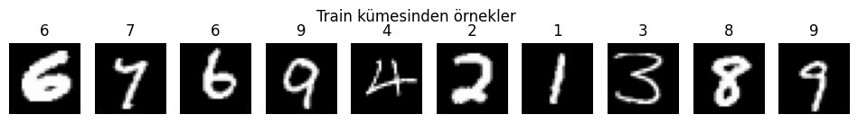
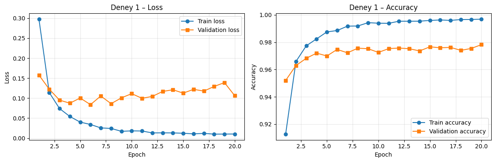
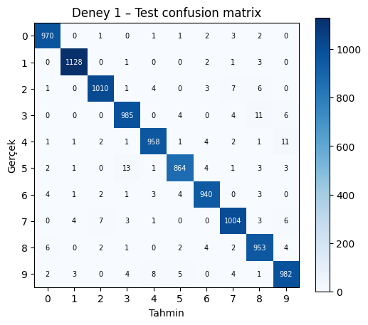
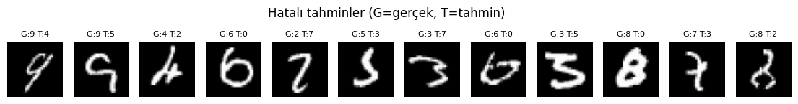
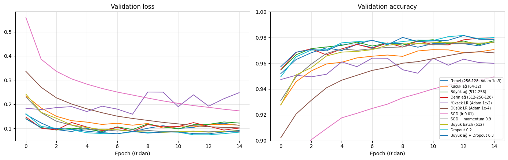
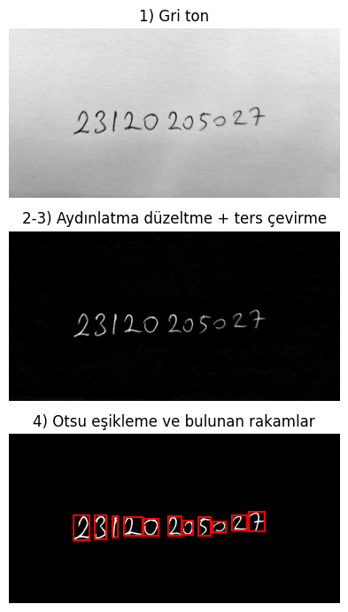
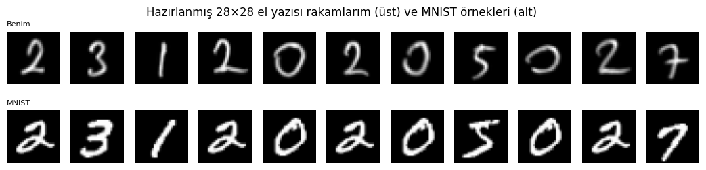
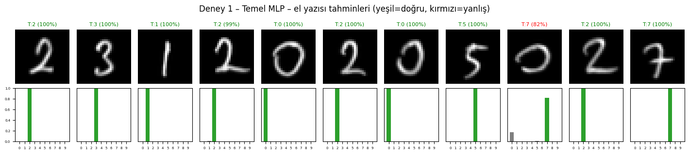
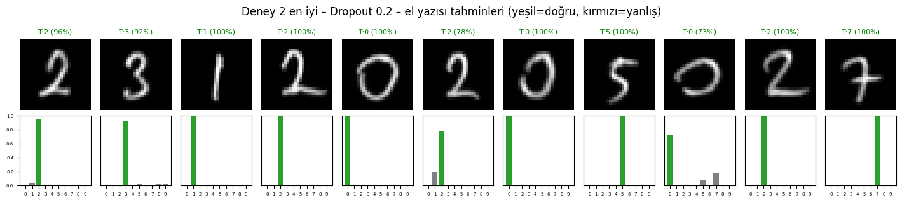

# MNIST ile MLP Tabanlı El Yazısı Rakam Tanıma

**Öğrenci No:** 23120205027
**Kütüphane:** PyTorch. Model sıfırdan eğitildi; CNN veya hazır eğitilmiş model kullanılmadı.
**Ortam:** Google Colab, T4 GPU

## Dosyalar

| Dosya | Açıklama |
|---|---|
| `mnist_mlp.ipynb` | Tüm kod ve çıktıları: veri hazırlama, Deney 1, Deney 2, el yazısı tahmini |
| `okulnoelyazisi.jpeg` | Kendi el yazımla yazdığım okul numaramın orijinal fotoğrafı |
| `el_yazisi_28x28/` | Fotoğraftan çıkarılıp MNIST formatına getirilmiş 28×28 rakamlar (`sıra_etiket.png`) |
| `grafikler/` | Notebook'tan alınan grafikler |
| `requirements.txt` | Gerekli kütüphaneler |

## Çalıştırma

- **Colab:** `mnist_mlp.ipynb` dosyasını Colab'da açın ve `Tümünü çalıştır` deyin. El yazısı hücresi fotoğrafı ister; `okulnoelyazisi.jpeg` dosyasını seçin.
- **Yerel:** `pip install -r requirements.txt`, ardından `jupyter notebook mnist_mlp.ipynb` (fotoğraf notebook ile aynı klasörde olmalı).

## Veri Ayrımı

| Küme | Kaynak | Boyut |
|---|---|---|
| Train | MNIST train kümesinden rastgele (seed = 42) | 50.000 |
| Validation | MNIST train kümesinin kalan kısmı | 10.000 |
| Test | MNIST test kümesi | 10.000 |

Model seçimi (en iyi epoch ve en iyi yapılandırma) yalnızca **validation accuracy** ile yapıldı. Test kümesi eğitimde ve model seçiminde kullanılmadı; yalnızca sonuçları raporlamak için kullanıldı.

Ön işleme: piksel değerleri [0, 1] aralığına ölçeklendi, ardından `(x − 0.1307) / 0.3081` ile normalize edildi. 28×28 görüntüler 784 boyutlu vektöre düzleştirildi.

## Deney 1 – Temel MLP

| Hiperparametre | Değer |
|---|---|
| Mimari | 784 → 256 → 128 → 10 (2 hidden layer, 235.146 parametre) |
| Aktivasyon | ReLU |
| Loss | CrossEntropyLoss |
| Optimizer | Adam, lr = 0.001 |
| Batch size | 128 |
| Epoch | 20 |
| Dropout / weight decay | yok |
| Seed | 42 |

Sonuçlar, validation accuracy'si en yüksek olan epoch'a (20. epoch) aittir:

| Metrik | Sonuç |
|---|---|
| Training loss | 0.0104 |
| Validation loss | 0.1060 |
| Training accuracy | %99.68 |
| Validation accuracy | %97.82 |
| **Test accuracy** | **%97.94** |
| Eğitim süresi | 14.1 sn (T4 GPU, 20 epoch) |

## Deney 2 – Hiperparametre Karşılaştırması

Temel modelden başlanıp her seferinde tek bir hiperparametre değiştirildi. Her yapılandırma 15 epoch eğitildi; tabloda validation'a göre en iyi epoch'un değerleri var.

| Yapılandırma | Param | Seçilen epoch | Train loss | Val loss | Train acc | Val acc | Test acc | Süre (sn) |
|---|---|---|---|---|---|---|---|---|
| Temel (256-128, Adam 1e-3) | 235.146 | 15 | 0.0122 | 0.1126 | %99.59 | %97.66 | %97.87 | 9.9 |
| Küçük ağ (64-32) | 52.650 | 15 | 0.0247 | 0.1135 | %99.21 | %97.07 | %97.51 | 9.5 |
| Büyük ağ (512-256) | 535.818 | 11 | 0.0147 | 0.0980 | %99.49 | %97.83 | %97.96 | 10.9 |
| Derin ağ (512-256-128) | 567.434 | 15 | 0.0133 | 0.1014 | %99.59 | %97.97 | %98.20 | 11.5 |
| Yüksek LR (Adam 1e-2) | 235.146 | 7 | 0.1129 | 0.1799 | %97.07 | %96.40 | %96.81 | 9.9 |
| Düşük LR (Adam 1e-4) | 235.146 | 14 | 0.0622 | 0.1042 | %98.25 | %96.90 | %97.37 | 9.5 |
| SGD (lr 0.01) | 235.146 | 15 | 0.1486 | 0.1728 | %95.77 | %94.95 | %95.45 | 7.9 |
| SGD + momentum 0.9 | 235.146 | 15 | 0.0057 | 0.0866 | %99.95 | %97.60 | %98.14 | 8.5 |
| Büyük batch (512) | 235.146 | 13 | 0.0124 | 0.0844 | %99.69 | %97.65 | %97.93 | 2.3 |
| **Dropout 0.2** | 235.146 | 13 | 0.0333 | 0.0737 | %98.88 | **%98.16** | %98.18 | 10.5 |
| Büyük ağ + Dropout 0.3 | 535.818 | 13 | 0.0373 | 0.0778 | %98.78 | %98.15 | %98.06 | 10.9 |

Validation accuracy'ye göre en iyi yapılandırma **Dropout 0.2** oldu (val %98.16, test %98.18).

## Kendi El Yazım

Okul numaramı beyaz kâğıda mavi tükenmez kalemle yazıp telefonla fotoğrafladım (`okulnoelyazisi.jpeg`). MNIST formatına getirmek için uygulanan adımlar:

1. Gri tonlamaya çevirme
2. Aydınlatma düzeltme: Gaussian blur ile arka plan tahmin edildi ve görüntü bu arka plana bölündü
3. Renkleri ters çevirme: MNIST'teki gibi siyah arka plan, beyaz rakam
4. Otsu eşikleme ve bağlantılı bileşen analiziyle 11 rakamı ayırma
5. Çizgi kalınlaştırma: tükenmez kalem çizgisi MNIST'e göre ince olduğu için dilation uygulandı
6. Rakamı en-boy oranını koruyarak 20×20 kutuya sığdırma, 28×28 tuvale yerleştirme ve kütle merkezine göre ortalama
7. Eğitim verisiyle aynı normalizasyon: `(x − 0.1307) / 0.3081`

| Model | Gerçek | Tahmin | Doğru |
|---|---|---|---|
| Deney 1 – Temel MLP | 23120205027 | 2312020572**7** | 10/11 (%90.9) |
| Deney 2 en iyi – Dropout 0.2 | 23120205027 | 23120205027 | 11/11 (%100) |

## Genel Değerlendirme

**Temel model.** 2 hidden layer'lı basit bir MLP, MNIST test kümesinde %97.94 doğruluğa ulaştı. Validation (%97.82) ve test (%97.94) sonuçlarının çok yakın olması, validation kümesinin modelin görmediği veriler için iyi bir tahmin verdiğini gösteriyor.

**Overfitting.** Deney 1'de train loss sürekli düştü (0.30 → 0.01), fakat validation loss en düşük değerine 6. epoch'ta ulaştı (0.084) ve sonrasında dalgalanarak yükseldi (19. epoch'ta 0.139). Train accuracy %99.7'ye çıkarken validation accuracy %97.5–97.8 civarında kaldı. Bu yaklaşık 2 puanlık fark, modelin eğitim verisini ezberlemeye başladığını gösteriyor. Validation accuracy'nin yine de düşmemesinin nedeni, modelin yanlış tahminlerde daha emin hâle gelmesi: bu durum loss'u artırıyor ama doğru/yanlış sayısını pek değiştirmiyor.

**Hiperparametrelerin etkisi.**
- *Regularization:* En iyi sonuç Dropout 0.2 ile alındı. Dropout train/val farkını küçülttü (train %98.88, val %98.16) ve en düşük validation loss'u (0.074) verdi. Bu, temel modeldeki sorunun overfitting olduğunu doğruluyor.
- *Ağ boyutu:* Küçük ağ (64-32), 4.5 kat daha az parametreyle yalnızca 0.6 puan geride kaldı. Büyük ve derin ağlar küçük bir iyileşme sağladı, ama dropout'un getirdiği iyileşme daha fazlaydı.
- *Learning rate:* Adam ile lr = 0.01 eğitimi kararsız hâle getirdi (en iyi epoch 7, val %96.40). lr = 0.0001 ise yavaş öğrendi ve 15 epoch'ta yakınsamadı (val %96.90).
- *Optimizer:* Momentumsuz SGD (lr = 0.01) en kötü sonucu verdi (%94.95). Momentum 0.9 eklenince SGD, Adam ile aynı seviyeye çıktı (%97.60).
- *Batch size:* 512, 128'e çok yakın doğruluk verdi ve yaklaşık 4 kat daha hızlı eğitildi (2.3 sn ve 9.9 sn), çünkü epoch başına daha az parametre güncellemesi yapılıyor.

**Gerçek dünya verisi (distribution shift).** Kendi el yazımda temel model 11 rakamdan 10'unu, dropout'lu model ise 11'ini de doğru tahmin etti. Temel modelin hatası 9. rakamdaydı: küçük ve yatay olarak geniş yazdığım `0` rakamını %82 olasılıkla `7` diye tahmin etti. MNIST'teki sıfırlar genellikle dikey ve oval olduğu için bu şekil eğitim dağılımının dışında kalıyor. Fotoğraftaki rakamlar MNIST'ten birkaç açıdan farklı:
- tükenmez kalem çizgisi MNIST'e göre çok ince
- kâğıt üzerinde aydınlatma farkı ve gölge var
- rakam boyutları ve oranları farklı

Bu farkları azaltmak için ön işlemede çizgi kalınlaştırma, aydınlatma düzeltme ve MNIST'teki gibi 20×20 kutuya sığdırıp kütle merkezine göre ortalama adımları uygulandı. Bu adımlar olmadan model büyük ihtimalle çok daha fazla hata yapardı.

Dropout'lu modelin el yazımda daha iyi sonuç vermesi, regularization'ın modelin farklı dağılımdan gelen verilere genelleme yeteneğini artırdığını düşündürüyor. Ancak örnek sayısı yalnızca 11 olduğu için 10/11 ile 11/11 arasındaki fark istatistiksel olarak güçlü bir kanıt sayılmaz. Daha güvenilir bir karşılaştırma için her rakamdan çok sayıda el yazısı örneği toplanmalıdır.

**Sınırlılıklar.** MLP, görüntüyü düz bir vektör olarak işlediği için pikseller arasındaki uzamsal ilişkiyi doğrudan öğrenemez. Bu yüzden konum, boyut ve kalınlık değişikliklerine karşı hassastır ve ön işlemenin kalitesi sonucu doğrudan etkiler. Data augmentation (küçük döndürme, kaydırma, kalınlık değişimi) bu hassasiyeti azaltabilir.
